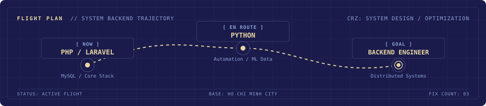
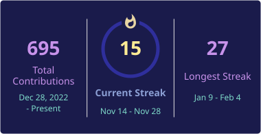

<picture>
  <source media="(prefers-color-scheme: dark)" srcset="./profile/header-dark.svg">
  <source media="(prefers-color-scheme: light)" srcset="./profile/header-light.svg">
  
</picture>

# Thanh Trieu Nguyen

Fresh graduate backend developer focused on PHP, Laravel, and Python.

I graduated in Information Technology from Vietnam Aviation Academy. I develop backend services and automation pipelines using PHP, Laravel, and MySQL, with practical focus on relational schema design and transaction concurrency. Currently studying system design, database optimization, and clean architecture principles, I am seeking a Junior Backend Developer position based in Ho Chi Minh City.

  
  
  
  

## Featured project

### [Aviation Weather AI](https://github.com/thanhtrieunguyen/aviation-weather-ai)

Weather hazard forecasting and flight risk assessment system designed for airport operations across Vietnam.

- Core stack: Python, Node.js, Vue, React Native
- Role: Individual developer
- Architecture: Ingests meteorological METAR observations, trains risk classification models (Random Forest, XGBoost, LightGBM), and serves automated alerts through an API service to dashboard and mobile clients.
- Documentation: [Repository](https://github.com/thanhtrieunguyen/aviation-weather-ai) | [Architecture reference](https://deepwiki.com/thanhtrieunguyen/aviation-weather-ai) | [Portfolio case study](https://trieuthanh.id.vn/)
<!-- TODO: Provide live demo link and interface screenshots if available -->

## Projects

| No. | Project | Role | Stack | Key details |
|:---:|:---|:---|:---|:---|
| 01 | [Aviation Weather AI](https://github.com/thanhtrieunguyen/aviation-weather-ai) | Developer | `Python` `Node.js` `Vue` `React Native` | Flight risk monitoring and automated meteorological alert pipeline |
| 02 | [VietCar Rental Web](https://github.com/thanhtrieunguyen/vietcar-rental-web) | Team Leader | `PHP` `Laravel` `MySQL` | Vehicle booking service with relational schema design and rental workflows |
| 03 | [Course Enrollment System](https://github.com/thanhtrieunguyen/course-enrollment-system) | Team Leader | `PHP` `Laravel` `MySQL` | Academic enrollment service using database row-locking to avoid overbooking |
| 04 | [GV Rating System](https://github.com/thanhtrieunguyen/gv-rating-system) | Developer | `PHP` `Blade` `Laravel` | Anonymous lecturer feedback service with salted hashing for student privacy |
| 05 | [Supercar Rental UI](https://github.com/thanhtrieunguyen/Supercar-Rental) | Developer | `JavaScript` `SCSS` | Responsive vehicle catalog and booking interaction interface |
<!-- TODO: Verify gv-rating-system repository visibility if currently private -->

## Skills

### Core backend and languages

### Secondary and tools

## GitHub activity

  
  

 

  <picture>
    <source media="(prefers-color-scheme: dark)" srcset="./profile/github-contribution-grid-snake-dark.svg">
    <source media="(prefers-color-scheme: light)" srcset="./profile/github-contribution-grid-snake.svg">
    
  </picture>

